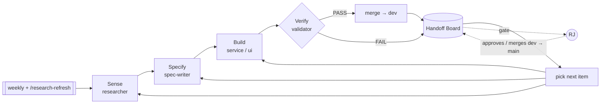

# Loop Protocol

The loop's state is the [[Handoff Board]]. The `/loop` command runs this protocol, and
`/research-refresh` (manually or on the weekly schedule) feeds new information into it.

## Board item lifecycle
`todo` → `doing` → `verify` → `done`
- On a validation failure the item returns to `todo` (attempts +1). After 3 attempts it becomes `needs-RJ`.
- `blocked`: waiting on another item or outside information (use the `depends` column).
- `needs-RJ`: a gate. The loop stops here.

## Picking the next item
Status `todo`, every `depends` item `done`, an agent owner (not RJ), highest priority first
(P0 > P1 > P2 > P3), then oldest ID first.

## Owners
| Owner | Agent | Typical work |
|---|---|---|
| researcher | `riftbound-researcher` | game facts, decklists, card data sources |
| spec-writer | `spec-writer` | requirements, data contracts, acceptance criteria |
| service-builder | `service-builder` | `services/`, data pipeline, API contracts |
| ui-builder | `ui-builder` | `web/`, screens (each finished screen goes to a `needs-RJ` review gate) |
| validator | `validator` | re-runs checks, regression sweeps |
| RJ | you | gates: ADRs, UI reviews, spec approvals, merging `dev` → `main` |

## Gates (the loop always stops for these)
1. Any ADR with status `proposed`
2. A UI screen ready for review
3. A spec newly marked `review` that changes legality or matching behavior
4. An item that failed validation 3 times
5. Anything destructive or irreversible, or anything that would touch outside services or accounts

## Git policy
- `main`: only RJ merges into it, from `dev`.
- `dev`: the loop's integration branch. It holds the board state.
- `loop/<ID>-<slug>`: one branch per board item, created from `dev` and merged back with
  `--no-ff` after the validator passes.
- `research/refresh-<date>`: one branch per research refresh, merged into `dev` the same way.
- Commit messages start with the item ID. Never push, force, or rebase `dev`/`main`.

## Round cap
Default 5 rounds per `/loop` run (`/loop 10` for more). Research refreshes are a single round.

## Research refresh
On demand with `/research-refresh [focus]`. The weekly scheduled run is **not set up yet**: RJ deleted the original task on 2026-11-23 and will recreate it inside the Claude project later (H-042). Until then, run it manually.
1. The researcher checks every source in the [[Research Index]] for changes since each note's `as_of` date.
2. Real changes go to the [[Change Feed]] and the affected notes are updated.
3. Each change that affects a spec gets a P1 board item for spec-writer. A ban change also gets
   a P0 item for validator to re-run V-001.
4. The validator runs documentation checks, and the result is merged into `dev`.
5. If nothing changed: a single line in the Change Feed and no board items.

## Keeping the brain light
At the end of every `/loop` run, the orchestrator:
- updates [[Current State]] (one screen; rewrite it, don't append)
- keeps only the latest 2 Session Log entries and moves older ones to `Archive/Sessions/`
- keeps the latest ~10 Done rows on the board and moves older ones to `Archive/Board/`
- keeps the latest round in [[Validation Runs]] and moves older lines to `Archive/Validation/`
- moves a superseded note to `Archive/` with `archived: true`, `archived_on`, `reason`, `superseded_by`, and fixes live links

## Session reporting
Every run appends to the [[Session Log]]: rounds run, items done, failures, gates hit, and what comes next.
