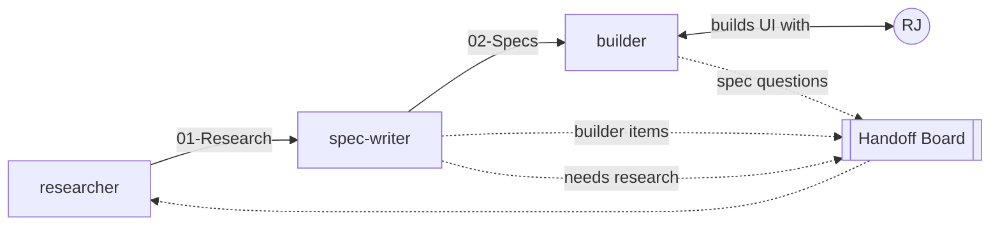

# 🧠 Riftbound Deck Builder: Home

> Import the Riftbound cards you physically own → see which meta decks you can build, which
> you're close to, and what's missing.

## Map
- **[[Current State]]: start here**
- [[Product Vision]]: what we're building and for whom
- [[Research Index]]: rules, bans, meta, tournaments, card data (researcher)
- [[Spec Index]]: buildable specifications (spec-writer)
- [[Decision Log]]: architecture decisions / ADRs
- [[UI Index]]: screens & design decisions (builder + RJ)
- [[API Contracts]]: service ↔ UI contract (builder)
- [[Handoff Board]]: requests between agents
- [[Session Log]]: what happened, when
- [[Loop Protocol]] · [[Validation Checks]] · [[Change Feed]]: the closed dev loop

## Folders
| Folder | Purpose | Owner |
|---|---|---|
| `00-Inbox` | Quick captures, unsorted ideas | anyone |
| `01-Research` | Sourced, dated game facts | researcher |
| `02-Specs` | Testable requirements | spec-writer |
| `03-Decisions` | ADRs | RJ approves |
| `04-Product` / `04-UI` | Vision, screens, design | RJ + builder |
| `05-Services` / `05-Handoffs` | API contracts, agent requests | builder / all |
| `06-Sessions` | Session log | all |
| `07-Loop` | Loop protocol, validation checks & runs | validator |
| `Templates` | Note templates | — |
| `Archive` | History: old sessions, finished board items, old validation runs, spec changelogs. **Low priority.** | — |

## Pipeline

